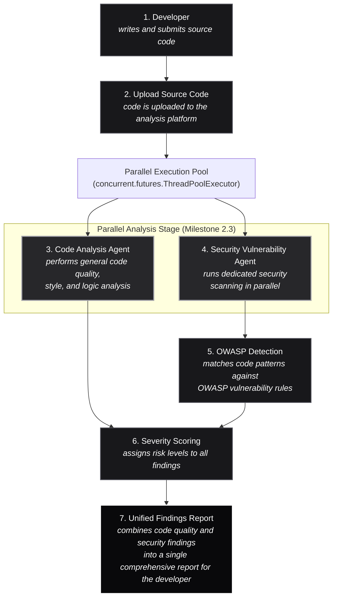

# AegisAI — AI Code Review & Security Analysis Agent

[-red.svg)](https://owasp.org/Top10/)
[](https://python.org)
[](https://fastapi.tiangolo.com)
[](https://www.trychroma.com)

An automated, intelligent multi-agent platform for reviewing code quality, detecting **OWASP Top 10 (2025)** security vulnerabilities, generating RAG-grounded remediations with before-and-after code diffs, producing pull-request review summaries, and facilitating interactive conversational code assistance.

---

## 🌟 Key Features & Agent Architecture

1. **Code Submission Module (`backend/modules/submission.py`)**:
   - Direct code paste & file upload support for **Python** and **Java**.
   - Language detection and AST syntax validation (Python `ast.parse` and Java lexical analyzer).
   - Line count, cyclomatic complexity calculation, and code structure extraction.

2. **Code Analysis Agent (`backend/agents/code_analysis_agent.py`)**:
   - Detects code smells, design anti-patterns, God classes, deep nesting, long methods, and unused imports.

3. **Security Vulnerability Agent (`backend/agents/security_agent.py`)**:
   - Leverages a combination of open-source and enterprise-grade tools across Python, Java, and enterprise environments:
     - **Python**:
       - `Bandit`: Security-focused linter that scans Python code for common security issues (hardcoded passwords, weak cryptography, unsafe function calls).
       - `Semgrep`: Fast, lightweight static analysis tool supporting custom rules for bugs, security vulnerabilities, and anti-patterns.
       - `Pylint`: Code analysis tool checking coding standards, errors, and potential security issues for clean Python codebases.
     - **Java**:
       - `SpotBugs`: Detects bugs and security vulnerabilities in Java bytecode (null pointer dereferences, insecure cryptography, resource leaks).
       - `PMD`: Static code analyzer identifying common programming flaws, security issues, and code duplication in Java and JVM languages.
       - `Checkstyle`: Enforces coding conventions and best practices in Java for consistent and secure code standards.
     - **Enterprise**:
       - `SonarQube`: Comprehensive platform for continuous inspection of code quality and security across multiple languages with detailed vulnerability reports.
       - `Snyk`: Developer-first security tool finding vulnerabilities in open-source dependencies, containers, and infrastructure as code.
       - `OWASP Dependency Check`: Identifies known vulnerabilities (CVEs) in project dependencies by comparing them against the National Vulnerability Database (NVD).
   - Scans against the official **OWASP Top 10 (2025 Edition)** & CWE standards:
     - **A01: Broken Access Control** (`CWE-22`, `CWE-862`): Path traversal, missing authorization.
     - **A02: Security Misconfiguration** (`CWE-16`, `CWE-942`): Debug mode enabled, wildcard CORS `*`.
     - **A03: Software Supply Chain Failures** (`CWE-1104`): Risky/deprecated imports.
     - **A04: Cryptographic Failures** (`CWE-327`, `CWE-328`): Weak MD5/SHA1 hashing for passwords.
     - **A05: Injection** (`CWE-89`, `CWE-78`): SQL injection via formatted strings/JDBC concatenation, command injection.
     - **A06: Insecure Design** (`CWE-1059`): Missing rate limiting on auth endpoints.
     - **A07: Authentication Failures** (`CWE-798`): Hardcoded API keys, secrets, tokens, and passwords.
     - **A08: Software or Data Integrity Failures** (`CWE-502`): Unsafe deserialization (`pickle`, Java `ObjectInputStream`).
     - **A09: Security Logging and Alerting Failures** (`CWE-532`): Plaintext credential leakage in application logs.
     - **A10: Mishandling of Exceptional Conditions** (`CWE-755`, `CWE-390`): Bare `except: pass`, empty catch blocks.

### Security Vulnerability Agent Workflow

The platform executes a dedicated 7-step analysis pipeline where the **Code Analysis Agent** and **Security Vulnerability Agent** execute concurrently in parallel (Milestone 2.3):



#### Workflow Steps:
1. **Developer**: Writes and submits source code.
2. **Upload Source Code**: Code is uploaded to the analysis platform and validated.
3. **Code Analysis Agent**: Performs general code quality, style, and logic analysis.
4. **Security Vulnerability Agent**: Runs dedicated security scanning in parallel.
5. **OWASP Detection**: Matches code patterns against OWASP vulnerability rules.
6. **Severity Scoring**: Assigns risk levels to all findings.
7. **Unified Findings Report**: Combines code quality and security findings into a single comprehensive report for the developer.

---

### Code Analysis Agent
Performs automated structural and design quality inspection on submitted Python and Java code. Runs concurrently with the Security Vulnerability Agent to analyze cyclomatic complexity, God classes, deep conditional nesting (>3 levels), long methods, duplicate logic, and code smells without blocking the pipeline.

### Security Vulnerability Agent
Runs dedicated static security scanning concurrently with code analysis. Evaluates the codebase against the 10 categories of OWASP Top 10 (2025 Edition), correlates findings with CWE standards, interfaces with multi-tier toolchains (Bandit, Semgrep, Pylint, SpotBugs, PMD, Checkstyle, SonarQube, Snyk, OWASP Dependency Check), and streams flagged issues directly into RAG-grounded remediation and pull-request summary generation.

---

4. **Remediation Agent (`backend/agents/remediation_agent.py`)**:
   - Queries the Secure Coding Knowledge Base (RAG) to generate corrected replacement code, unified diffs, and remediation roadmaps.

5. **PR Summary Agent (`backend/agents/pr_summary_agent.py`)**:
   - Computes weighted risk & health scores (0-100), PR merge gate recommendation (`APPROVED`, `CHANGES_REQUESTED`, `BLOCKING_SECURITY_RISK`), and executive markdown summary.

6. **Conversational Code Assistant (`backend/agents/conversational_agent.py`)**:
   - RAG-powered interactive Q&A assistant grounded in the secure coding knowledge base and the user's active code context.

7. **Report Generation & Export Module (`backend/modules/report_generator.py`)**:
   - Export reports as structured **JSON**, GitHub-ready **Markdown**, and executive **PDF** reports (via `reportlab`).

---

## 🚀 Quickstart Guide

### 1. Run the Platform
```bash
python run.py
```

### 2. Command-Line Interface (CLI)
You can also run scans, check syntax, or query the knowledge base from your terminal:
```bash
# Scan a source file and output review findings
python cli.py scan backend/test_samples/python/vulnerable_sqli_secrets.py

# Scan and export to an executive PDF report
python cli.py scan backend/test_samples/python/vulnerable_sqli_secrets.py --output report.pdf

# Validate syntax and check cyclomatic complexity
python cli.py validate backend/test_samples/java/VulnerableAuthApp.java

# Query the Secure Coding Knowledge Base (RAG)
python cli.py kb-search "SQL injection prepared statements"
```

### 3. Automated Test Suite (100% Pass Rate)
Run the complete test suite with `pytest`:
```bash
python -m pytest tests/ -v
```
All 20 test cases verify syntax validation, OWASP Top 10 (2025) detection, RAG retrieval, automated regression test generation, and REST API endpoints.

---

## 📂 Project Structure

```
.
├── run.py                          # Single-command launcher (seeding + dev server)
├── cli.py                          # Terminal CLI tool for scanning & RAG search
├── pytest.ini                      # Pytest configuration
├── requirements.txt                # Python dependencies
├── tests/                          # Automated pytest suite (20 tests)
│   ├── test_submission.py          # AST syntax validation & language detection
│   ├── test_agents.py              # Quality, OWASP 2025, remediation & PR agents
│   ├── test_rag.py                 # Vector store, semantic search & chat assistant
│   └── test_api.py                 # FastAPI endpoints & export integration
├── backend/
│   ├── app.py                      # FastAPI server & route handlers
│   ├── config.py                   # App configuration & directory paths
│   ├── models/
│   │   └── schemas.py              # Pydantic data schemas
│   ├── modules/
│   │   ├── submission.py           # Syntax validation & language detection
│   │   └── report_generator.py     # PDF, Markdown, and JSON exporters
│   ├── rag/
│   │   ├── vector_store.py         # Persistent ChromaDB + Semantic indexer
│   │   ├── seed_knowledge_base.py  # Ingestion & verification script
│   │   ├── retriever.py            # RAG semantic retrieval
│   │   └── documents/              # OWASP 2025, CWE, Python & Java guidelines
│   ├── agents/
│   │   ├── base_agent.py           # Abstract Base Agent
│   │   ├── code_analysis_agent.py  # Quality & Code Smells Agent
│   │   ├── security_agent.py       # OWASP 2025 Security Agent
│   │   ├── remediation_agent.py    # RAG Remediation & Unit Test Generator
│   │   ├── pr_summary_agent.py     # Pull Request Summary Agent
│   │   ├── conversational_agent.py # RAG Chat Assistant Agent
│   │   └── orchestrator.py         # Multi-Agent Orchestration Pipeline
│   └── test_samples/               # Python & Java test files (vulnerable and secure)
└── frontend/
    ├── index.html                  # Modern Developer Portal
    ├── css/
    │   └── style.css               # Glassmorphic dark design system
    └── js/
        └── app.js                  # Frontend client logic & live stepper
```

