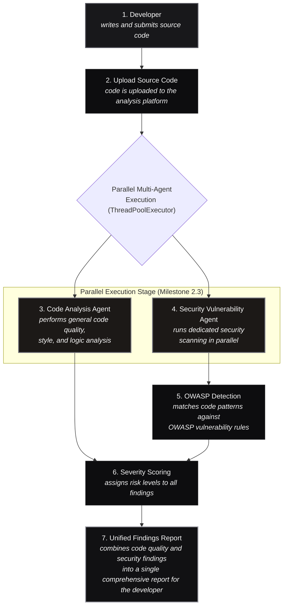

# Security Vulnerability Agent & Workflow Architecture Guide

## 1. Overview & Multi-Tier Tool Ecosystem

The **Security Vulnerability Agent** in **AegisAI** is engineered to deliver enterprise-grade static application security testing (SAST), software composition analysis (SCA), and OWASP Top 10 (2025 Edition) vulnerability scanning. To provide deep semantic and syntactic coverage, the platform leverages a combination of open-source and enterprise-grade tools across Python, Java, and enterprise environments.

### 1.1 Multi-Tier Tool Ecosystem

```
+----------------------------------------------------------------------------------------------------+
|                               AEGISAI TOOL ECOSYSTEM INTEGRATION                                  |
+------------------------------------+--------------------------------+------------------------------+
|               PYTHON               |              JAVA              |          ENTERPRISE          |
+------------------------------------+--------------------------------+------------------------------+
| • Bandit (AST Security Linter)     | • SpotBugs (Bytecode Analysis) | • SonarQube (Continuous SAST)|
| • Semgrep (Semantic Pattern Match) | • PMD (Static Code Analyzer)   | • Snyk (Container & SCA)     |
| • Pylint (Standards & Security)    | • Checkstyle (Code Standards)  | • OWASP Dependency Check     |
+------------------------------------+--------------------------------+------------------------------+
```

#### Python

- **Bandit** — A security-focused linter that scans Python code for common security issues such as hardcoded passwords, use of weak cryptography, and unsafe function calls.
- **Semgrep** — A fast, lightweight static analysis tool that supports custom rules for finding bugs, security vulnerabilities, and anti-patterns in Python code.
- **Pylint** — A code analysis tool that checks for coding standards, errors, and potential security issues, helping maintain clean and secure Python codebases.

#### Java

- **SpotBugs** — Detects bugs and security vulnerabilities in Java bytecode, including null pointer dereferences, insecure cryptography, and resource leaks.
- **PMD** — A static code analyzer that identifies common programming flaws, security issues, and code duplication in Java and other JVM languages.
- **Checkstyle** — Enforces coding conventions and best practices in Java, helping teams maintain consistent and secure code standards.

#### Enterprise

- **SonarQube** — A comprehensive platform for continuous inspection of code quality and security, supporting multiple languages with detailed vulnerability reports.
- **Snyk** — A developer-first security tool that finds vulnerabilities in open-source dependencies, containers, and infrastructure as code.
- **OWASP Dependency Check** — Identifies known vulnerabilities (CVEs) in project dependencies by comparing them with the National Vulnerability Database.

---

## 2. Security Vulnerability Agent Workflow

The analysis pipeline processes source files through a 7-step orchestrated workflow with milestone 2.3 parallel multi-agent execution:



### Detailed Workflow Step Breakdown

1. **Developer**:
   Writes and submits source code via direct paste into the Code Editor or file drag-and-drop (`.py` for Python or `.java` for Java).

2. **Upload Source Code**:
   Code is uploaded to the analysis platform. The `CodeSubmissionModule` automatically detects language indicators, verifies AST syntax validity (`ast.parse` in Python, lexical analyzer in Java), calculates cyclomatic complexity, and checks for delimiter balance.

3. **Code Analysis Agent**:
   Executes in parallel with security scanning. Performs deep code quality inspection, detects code smells (God classes, long methods > 50 lines, deep nesting > 3 levels), style defects, and anti-patterns.

4. **Security Vulnerability Agent**:
   Runs dedicated security scanning in parallel using `concurrent.futures.ThreadPoolExecutor`. Analyzes code against the official **OWASP Top 10 (2025 Edition)** suites and CWE taxonomy definitions.

5. **OWASP Detection**:
   Matches syntactic and AST code patterns against OWASP 2025 vulnerability rules:
   - `A01:2025 - Broken Access Control` (Path traversal, missing auth)
   - `A02:2025 - Security Misconfiguration` (Debug mode, wildcard CORS)
   - `A03:2025 - Software Supply Chain Failures` (Risky imports)
   - `A04:2025 - Cryptographic Failures` (Weak MD5/SHA1 hashing)
   - `A05:2025 - Injection` (SQL injection, Command injection)
   - `A06:2025 - Insecure Design` (Missing endpoint rate limiting)
   - `A07:2025 - Authentication Failures` (Hardcoded API keys, secrets)
   - `A08:2025 - Software & Data Integrity Failures` (Insecure deserialization)
   - `A09:2025 - Security Logging & Alerting Failures` (Credential leaks in logs)
   - `A10:2025 - Mishandling of Exceptional Conditions` (Bare except / empty catch)

6. **Severity Scoring**:
   Assigns standardized risk levels (`CRITICAL`, `HIGH`, `MEDIUM`, `LOW`, `INFO`) based on CVSS / OWASP risk impact formulas, and calculates an overall health and security score out of 100.

7. **Unified Findings Report**:
   Combines code quality and security findings into a single comprehensive report for the developer, ready for interactive web viewing or export as **JSON**, **GitHub Markdown**, or executive **PDF**.

---

## 3. Parallel Execution Implementation (Milestone 2.3)

In `backend/agents/orchestrator.py`, the Code Analysis Agent and Security Vulnerability Agent execute concurrently:

```python
# Steps 2 & 3: Run Code Analysis Agent and Security Vulnerability Agent in parallel (Milestone 2.3)
t_parallel_start = time.perf_counter()
with concurrent.futures.ThreadPoolExecutor(max_workers=2) as executor:
    future_code = executor.submit(
        self.code_agent.run,
        code=submission.code,
        language=validation.language,
        ast_summary=validation.ast_summary,
    )
    future_sec = executor.submit(
        self.sec_agent.run,
        code=submission.code,
        language=validation.language,
        filename=validation.filename,
    )
    quality_findings = future_code.result()
    security_findings = future_sec.result()

elapsed_parallel = round(time.perf_counter() - t_parallel_start, 4)
timings["code_analysis_agent"] = elapsed_parallel
timings["security_agent"] = elapsed_parallel
timings["parallel_execution"] = elapsed_parallel
```

---

## Code Analysis Agent

The **Code Analysis Agent** (`backend/agents/code_analysis_agent.py`) is responsible for non-security structural health and code maintainability:
- **God Class Detection**: Identifies classes with excessive method counts (>10) or single points of failure.
- **Deep Nesting**: Flags cyclomatic control flow depth greater than 3 levels, recommending guard clause refactoring.
- **Long Methods**: Flags functions exceeding 50 statements that violate the Single Responsibility Principle.
- **Dead & Unused Code**: Flags unreachable code segments and unused package imports.
- **Style & Clean Architecture**: Detects mutable default parameters, duplicate logic blocks, and naming violations.

---

## Security Vulnerability Agent

The **Security Vulnerability Agent** (`backend/agents/security_agent.py`) provides defense-in-depth vulnerability scanning:
- **OWASP Top 10 (2025 Edition)**: Full 10-category scanning tailored for modern API, cloud-native, and AI-era codebases.
- **CWE Benchmark Mapping**: Maps every finding to its authoritative Common Weakness Enumeration ID (e.g., `CWE-89`, `CWE-798`, `CWE-22`, `CWE-502`).
- **Polyglot Rulesets**: Dual Python and Java detection modules with regex pattern matching, AST traversal, and context validation.
- **Integration with Tool Ecosystem**: Designed to work in concert with external SAST/SCA analyzers including Bandit, Semgrep, SpotBugs, PMD, SonarQube, Snyk, and OWASP Dependency Check.
- **Direct Feed to RAG Remediation**: Directly passes detected vulnerabilities into the RAG retriever to generate exact replacement code and before-and-after diffs.
